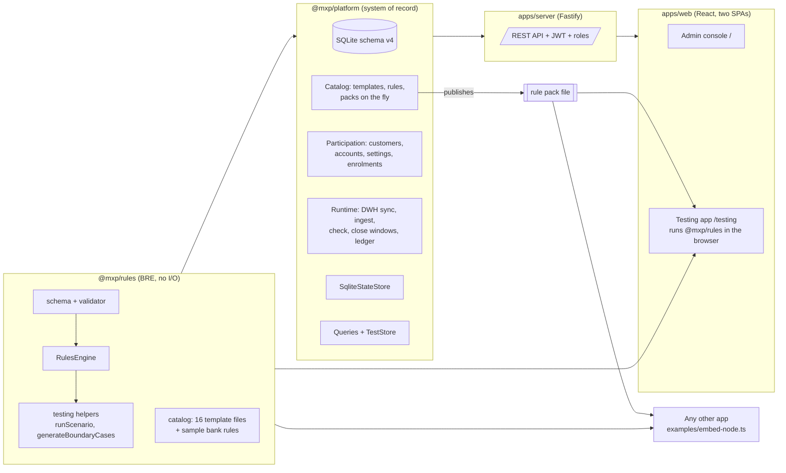
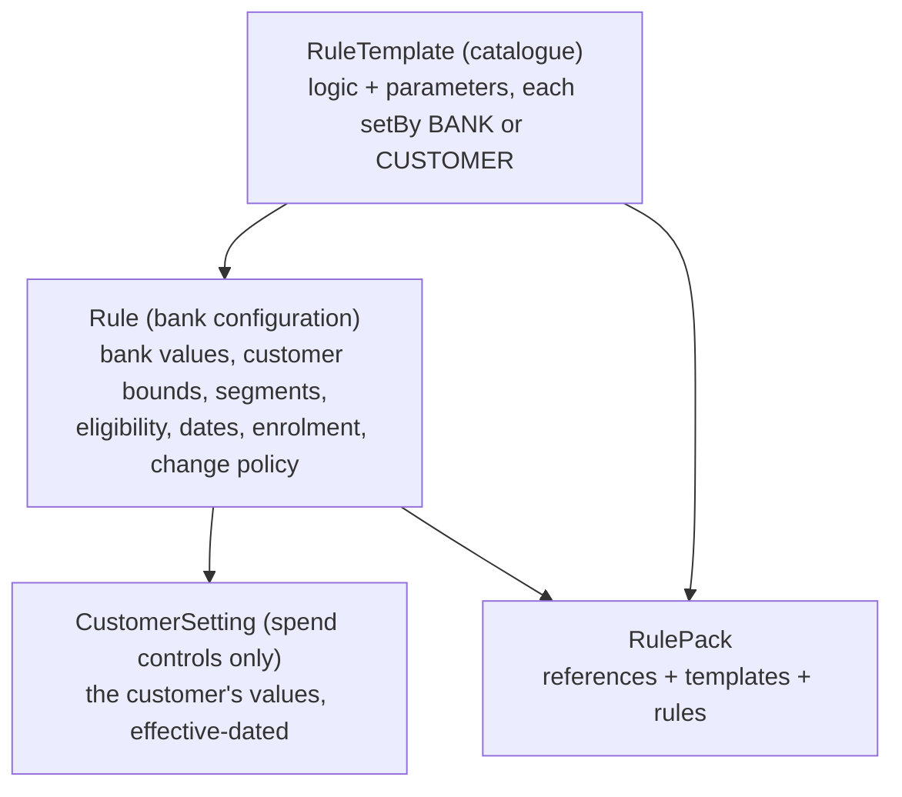
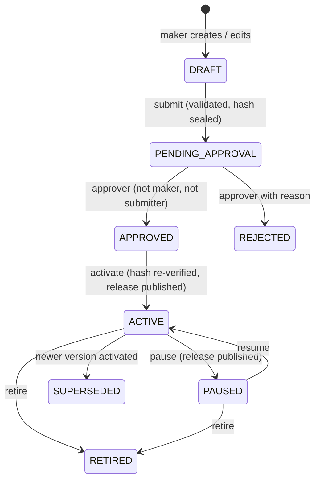

# 2. Architecture

## 2.1 Packages



| Package | Responsibility | Depends on |
|---|---|---|
| `packages/rules` (`@mxp/rules`) | Rule file schema, validation, the engine, the state-store interface, scenario runner, boundary-case generator, built-in catalogue. Runs in Node, browsers and edge runtimes. | zod |
| `packages/platform` (`@mxp/platform`) | SQLite schema, rule lifecycle and releases, customer settings, event ingestion, persistence of outcomes and points, audit chain, reporting queries, seed data. | `@mxp/rules` |
| `apps/server` | HTTP API, authentication, authorisation, rate limiting, CSV/JSON exports, window-close worker, static hosting of the web apps. | `@mxp/platform` |
| `apps/web` | Admin console and testing app (two Vite entry points sharing components). | `@mxp/rules` (testing app runs the engine locally) |

The key design choice: **rule logic only exists in rule files**. The database stores those files (verbatim and hashed) plus normalised copies of the parts that need querying. The engine never reads the database; it reads a pack file and a state store. That is what makes the module reusable by other apps.

## 2.2 Rule file layers



A mission template's parameters are all `setBy: BANK`. A spend control template has at least one `setBy: CUSTOMER` parameter; the rule sets bounds on it and the customer picks the value.

## 2.3 Runtime flows

### Event ingestion (transactions, balances, referrals, RD/FD events)

```mermaid
sequenceDiagram
  participant Src as Source system
  participant API as POST /api/events
  participant RT as Runtime
  participant ENG as RulesEngine (current release)
  participant DB as SQLite
  Src->>API: event (sourceSystem, sourceEventId, type, customerId, timestamp, fields)
  API->>RT: ingest
  RT->>DB: duplicate? (source_system, source_event_id)
  alt same id, same payload
    RT-->>API: duplicate, no effect
  else same id, different payload
    RT-->>API: 409 EVENT_CONFLICT
  else new
    RT->>DB: BEGIN; insert transaction (RECEIVED)
    RT->>RT: build context: customer facts, accounts, settings, enrolments
    RT->>ENG: process(event, context, SqliteStateStore)
    ENG->>DB: read/write window, rolling, lifetime and index state
    ENG-->>RT: decision, evaluations, effects
    RT->>DB: rule_evaluation, points_ledger (idempotency key), points_account,<br/>nudge; event PROCESSED; COMMIT
  end
```

An exception rolls back the transaction and records the event as FAILED with the error text; re-sending it retries.

### Pre-authorisation check (spend controls)

`POST /api/controls/check` runs `engine.check()`: the same evaluation on an overlay of the state, nothing written except a `control_decision` row with the decision, reasons and latency. The strictest decision wins: ALLOW < WARN < ALERT < BLOCK.

### Window close (compliance rewards, end-of-period missions)

A worker in the server process (and `POST /api/ops/close-windows`) calls `engine.close(asOf)`. Every OPEN window whose `closeAfter` (window end + grace days) is before `asOf` is settled: spend controls become COMPLIANT (points), BREACHED or NO_ACTIVITY; missions measured at close (averages) are paid or MISSED. Running it twice is a no-op.

### Rule change to live



Every change to the live set writes a `rule_pack_release` row with the full pack JSON and its hash and marks it current. The engine is cached per release id, so a release takes effect on the next event without a restart. The same file is downloadable (`GET /api/packs/current?download=1`) for other apps.

## 2.4 State model inside the engine

The engine keeps all state behind a four-method interface:

```ts
interface StateStore {
  get(key: string): unknown;
  set(key: string, value: unknown): void;
  dueWindows(date: string): WindowState[]; // OPEN windows with closeAfter < date
}
```

| Key prefix | Content | Table in the platform |
|---|---|---|
| `w\|rule\|subject\|window` | Window state: measure, contributions per event, breaches, tiers achieved, points held per slot | `rule_window_state` |
| `r\|rule\|subject` | Rolling-window contributions | `rule_rolling_state` |
| `l\|rule\|subject` | Lifetime counters and streaks | `rule_lifetime_state` |
| `x\|rule\|subject\|event` | Which window and contribution an event landed in (idempotency, reversals) | `rule_event_index` |

`MemoryStateStore` (tests, browser, simple hosts) and `SqliteStateStore` (platform) implement it. A host on Redis or DynamoDB implements the same three methods.

## 2.5 Testing architecture

The testing app fetches a pack (`/api/packs/preview?source=CURRENT|OPEN` or an uploaded file) and runs `@mxp/rules` in the browser with a `MemoryStateStore`. Results are identical to the server because it is the same code and the same file. Scenarios and run results are stored on the server (`test_scenario`, `test_run`) so a team shares one regression suite and history.

## 2.6 Security and operations

- JWT sessions; six roles mapped to permissions (see [05-api.md](05-api.md)). Password hashing with scrypt; lockout after 5 failures for 15 minutes.
- Maker-checker on rule changes; reasons required for reject, pause, retire and manual point adjustments.
- Append-only `points_ledger`, `rule_evaluation` and `audit_log` enforced by triggers; `audit_log` is hash-chained and verifiable (`GET /api/audit/verify`).
- Security headers, rate limiting, request validation with zod on every write.
- Configuration through environment variables (`MXP_ENV`, `MXP_DB`, `MXP_JWT_SECRET`, `MXP_WORKER`, `MXP_WORKER_INTERVAL_MS`, `MXP_SEED`, `PORT`). `render.yaml` deploys the server and both apps as one service.
