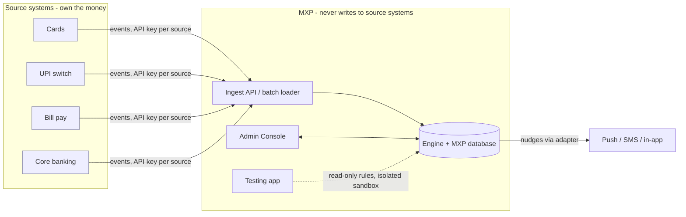
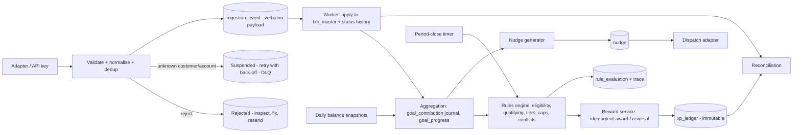

# 02 – Architecture and data flow

## 1. Context



## 2. Pipeline



| Stage | Module (`packages/engine/src`) | Responsibility |
|---|---|---|
| Adapters / API | `ingest.ts` + `apps/server/src/routes/ops.ts` | Canonical envelope, API-key auth bound to a source system |
| Validate / normalise / dedup | `ingest.ts` | Zod schemas, reference-data checks, minor units, UTC, content hash |
| Master | `ingest.ts`, `worker.ts` | Upsert `txn_master`, forward-only status, history, link refunds to originals |
| Aggregation | `aggregate.ts` | Append contributions to a journal; maintain `goal_progress` incrementally |
| Rules engine | `evaluator.ts`, `conditions.ts`, `fields.ts` | Eligibility, qualifying, tier, cap, conflict; builds a trace |
| Reward service | `ledger.ts` | Convergent award / reversal with idempotency keys |
| Nudges | `nudge.ts` | Generation, consent, channel and cap policy, dedupe, adapter dispatch |
| Admin | `ruleRepo.ts`, `validation.ts`, `campaigns.ts`, `security.ts`, `audit.ts` | Versions, lifecycle, maker-checker, RBAC, audit |
| Simulation | `sim.ts`, `simgen.ts`, `simstore.ts`, `simperf.ts`, `preview.ts` | Sandbox runs, matrix generator, suites, performance, preview on real history |
| Monitoring | `recon.ts`, `worker.ts` | Reconciliation checks, queue health, period close |

## 3. Not scanning the transaction database

The brief is explicit: do not re-scan the master for each rule. MXP is **transaction-driven with pre-computed windowed aggregates**:

1. A transaction event arrives; the engine takes the **live rule versions** (a handful of rows, not transactions) and applies a cheap scope check (channel, product) before any condition runs.
2. For each in-scope rule it evaluates eligibility and qualifying conditions against **that one transaction**.
3. The result is appended to `goal_contribution` (`APPLY` / `REVERSE`, with amount and count deltas) and added to the single `goal_progress` row for `(customer, rule version, period)`.
4. Tier achievement is computed from that row alone. No query touches other transactions.
5. Balance goals read from `balance_snapshot` for one account and one period, an indexed range of at most ~31 rows.
6. Combined goals read the component `goal_progress` rows.
7. Period close walks only **open** `goal_progress` rows (`IN_PROGRESS`, `ACHIEVED`, `DATA_UNAVAILABLE`) and skips those whose period has not ended; closed periods are never revisited.

Cost per transaction is independent of history size. The only operation that reads history is an explicit, operator-triggered **backfill / replay** (used when a rule is activated with backfill or a new version needs to catch up), and it works through `txn_master` indexed by customer and time.

Measured on a developer laptop with `scripts/perf.ts` (300 customers, 7,500–9,000 events each including 10 % duplicate deliveries, single SQLite file, in process): **2,700–3,900 events/s end to end, per-event engine latency p50 ≈ 0.3 ms and p99 < 0.7 ms, zero duplicate awards, reconciliation passed.** The same run is available from the Performance page of the Testing app. These are sandbox figures for a single process; size production on your own hardware and database.

## 4. Component view

```mermaid
flowchart TB
  subgraph Browser
    A1[Admin Console - React, Vite, route /]
    A2[Testing app - React, Vite, route /testing/]
  end
  subgraph Node[Node 22 - one process or split]
    S[Fastify API: auth, RBAC, validation, rate limit, security headers]
    W[Worker timers: process 1s, nudges 5s, period close 15 min]
    E[@mxp/engine]
    SIM[Sandbox: in-memory DB + same engine]
  end
  DB[(MXP database: SQLite via node:sqlite today, Postgres-compatible SQL)]
  SDB[(Simulation store: cases, runs, suites)]
  A1 & A2 --> S
  S --> E --> DB
  W --> E
  S --> SIM
  SIM -. read-only .-> DB
  SIM --> SDB
```

* `MXP_WORKER=0` runs an API-only instance; run one process with `MXP_WORKER=1` (the default) for the background timers. Simulation endpoints are CPU-bound and synchronous, so in production run them on a separate API instance.
* The database facade (`Db`) is a thin synchronous interface (`run`, `get`, `all`, `value`, `tx`, `exec`). The SQL is portable; [03](03-data-model.md) lists the PostgreSQL differences. A Postgres driver is the main production change.

## 5. Reliability design

| Concern | Mechanism |
|---|---|
| Idempotent ingest | Unique `(source_system, source_event_id)`; re-delivery increments `delivery_count`; changed content is `CONFLICTING_DUPLICATE`; the same business transaction under a new event id is still one `txn_master` row |
| Retry and DLQ | `SUSPENDED` / `FAILED` events retry with `retryBaseSeconds × 2^(n−1)` until `maxAttempts`, then `DEAD_LETTER`; operators can replay |
| Idempotent rewards | Ledger `idempotency_key` UNIQUE; award algorithm is convergent per slot |
| Crash safety | Each event is processed in one database transaction (savepoints); the queue is the event table, so a restart resumes |
| Replay | Raw payload stored verbatim; replay re-runs normalisation and evaluation |
| Ordering | Late, early, and out-of-order events converge to the same final ledger; closed periods are protected |
| Rule changes | Evaluations are tied to a **rule version**; a sealed definition hash is verified on load |
| Immutability | SQL triggers block UPDATE/DELETE on `xp_ledger`, `goal_contribution`, `audit_log`, `txn_master` (financial fields) |

## 6. Environment separation

| Env | `MXP_ENV` | Demo data | JWT secret | Notes |
|---|---|---|---|---|
| dev | `dev` | seeded when empty | generated | demo credentials shown on login |
| test | `test` | none | fixed in tests | in-memory databases |
| staging | `staging` | none | required, ≥24 chars | like prod, but without HSTS (set it at the proxy) |
| prod | `prod` | never; `seed` CLI refuses | required, ≥24 chars | one bootstrap admin from env |

Simulations never share a connection with production: the sandbox is an in-memory database populated from a read-only view of rules and reference data.

## 7. Key design decisions

| Decision | Reason |
|---|---|
| Money as integer minor units | No float drift; boundary at ₹9,999.99 vs ₹10,000 is exact |
| Rules stored as normalised tables **and** a sealed JSON definition | Queryable and versionable, yet tamper-evident |
| Journal + projection (`goal_contribution` + `goal_progress`) | Cheap reads, rebuildable, reconcilable |
| Slot-based awards (`tier:N`, `best`, `txn:<id>`) | Re-evaluation converges instead of appending duplicates |
| Same engine for sandbox and production | A passing simulation is evidence about production behaviour |
| Maker-checker by identity, not just by role | An approver who authored a version still cannot approve it |
