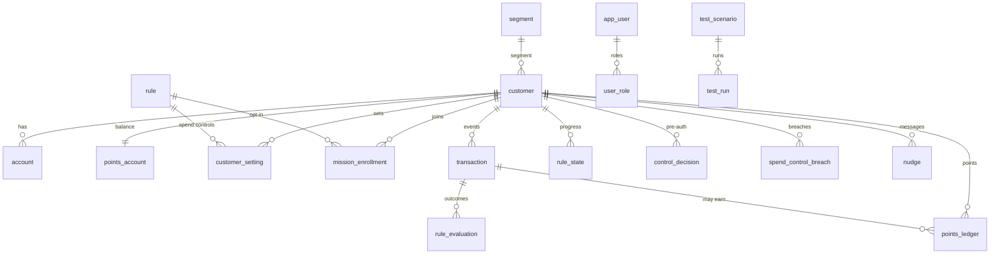

# 3. Data model (schema v3 — simplified)

Source of truth: [`packages/platform/src/schema.sql`](../packages/platform/src/schema.sql).  
**ERD (diagrams):** [erd.md](erd.md) · Spreadsheet: [mxp-table-relationships.xlsx](mxp-table-relationships.xlsx) (may lag).

v3 collapses the v2 cascade (template versions, rule versions, pack releases, setting versions, four state tables) into a flatter model. **Rule logic still lives in `@mxp/rules` JSON files**; the database stores bank configuration and runtime facts.

## 3.1 Principles

1. **Templates are package files**, not tables. Sixteen templates ship in `packages/rules/catalog/templates/`.
2. **One row per bank rule** (`rule`). Status: `DRAFT` → `ACTIVE` ⇄ `PAUSED` → `RETIRED`. Editing a live rule returns it to `DRAFT` until activated again.
3. **Packs are built on the fly** from ACTIVE/PAUSED rules + template files. No release-history table.
4. **Customer spend-control values** sit in one `customer_setting` row (optional `pending_*` for next-window changes).
5. **Engine state is one table** (`rule_state`) keyed by the BRE prefixes `w|`, `r|`, `l|`, `x|`.
6. **Points ledger and evaluations stay append-only** (triggers enforce immutability).

## 3.2 Entity relationships

Full diagrams (overview flowchart, attribute ERD, event sequence): **[erd.md](erd.md)**.



## 3.3 Tables (~22)

### Reference
| Table | Purpose |
|---|---|
| `segment` | MASS, AFFLUENT, YOUTH, SENIOR |
| `reference_value` | Channels, categories, txn types… for editors and packs |
| `merchant` | Merchant directory for restrictions / event builder |

### Customers
| Table | Purpose |
|---|---|
| `customer` | Tokenised customer, segment, timezone, attributes |
| `account` | Accounts / products |

### Rules
| Table | Purpose |
|---|---|
| `rule` | Bank rule file (`definition_json`), family, template code, status |

### Participation
| Table | Purpose |
|---|---|
| `customer_setting` | Customer-chosen spend-control values (+ optional pending change) |
| `mission_enrollment` | Opt-in missions |

### Runtime
| Table | Purpose |
|---|---|
| `transaction` | Event store (quoted `"transaction"` — reserved word) |
| `rule_state` | Unified engine state (windows, rolling, lifetime, event index) |
| `control_decision` | Pre-auth check log |
| `rule_evaluation` | Outcomes per rule per event/close |
| `spend_control_breach` | Limit breaches |
| `points_ledger` | Immutable points journal (`earned_on` = business date) |
| `points_account` | Balance projection |
| `nudge` | Customer messages |

### Governance
| Table | Purpose |
|---|---|
| `test_scenario` / `test_run` | Testing app regression cases |
| `app_user` / `user_role` | Console login |
| `audit_log` | Hash-chained change log |
| `schema_migration` | Schema version (currently **3**) |

## 3.4 What was removed vs v2

| Removed | Replaced by |
|---|---|
| `rule_template*` | Files in `@mxp/rules/catalog` |
| `rule_version`, `rule_param_value`, `rule_customer_param_bound`, `rule_segment` | Columns + JSON on `rule` |
| `rule_pack_release*` | `Catalog.buildPack()` / `engine()` cache |
| `customer_rule_setting_version`, `_value` | `customer_setting` (+ pending columns) |
| `rule_window_state`, `rule_rolling_state`, `rule_lifetime_state`, `rule_event_index` | `rule_state` |
| Maker–checker states | Draft → Activate |

## 3.5 How the two families use the tables

| Step | Mission | Spend control |
|---|---|---|
| Define | `rule` (targets in JSON) | `rule` (bounds in JSON) |
| Customer | `mission_enrollment` if OPT_IN | `customer_setting` |
| Event | `transaction` → `rule_state` → `rule_evaluation` → `points_ledger` | same + `spend_control_breach` / `control_decision` |

## 3.6 Fresh database

v3 is not migrated in place from v2. Recreate with:

```bash
npm run seed -- --force
```
