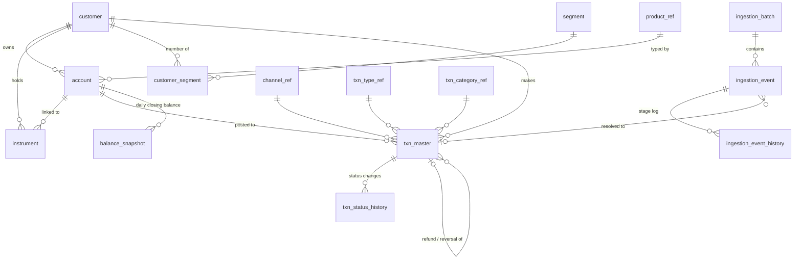
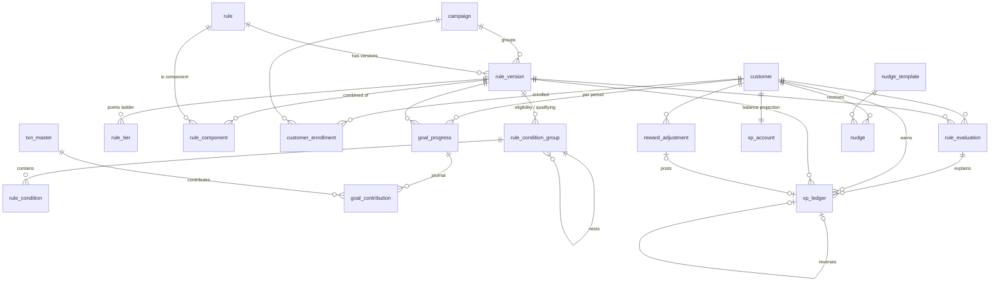
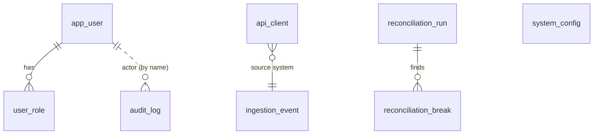

# 03 – ER diagram and schema

The authoritative DDL is [`packages/engine/src/schema.sql`](../packages/engine/src/schema.sql) (SQLite dialect, applied by `openDb`). This page explains it.

## 1. Conventions

* Money is stored as **integer minor units** (paise). Rule thresholds are written in major units (rupees) and converted on load.
* Timestamps are ISO-8601 UTC text; business dates are `YYYY-MM-DD` in the rule's time zone.
* **Facts are append-only** (`xp_ledger`, `goal_contribution`, `audit_log`, `txn_status_history`, `ingestion_event_history`). **Projections** (`goal_progress`, `xp_account`) can be rebuilt from facts and are reconciled.
* The transaction master is the financial source of truth; MXP writes gamification outcomes elsewhere, never into it.
* Data minimisation: `customer_ref` and `account_ref` are tokens; the customer name is masked; no PAN, Aadhaar or raw account numbers are stored.

## 2. ER diagram

### 2.1 Transactions, references and ingestion

### 2.2 Rules, campaigns, progress and rewards

### 2.3 Administration and control

## 3. Data dictionary

| Table | Purpose | Key columns and rules |
|---|---|---|
| `channel_ref`, `product_ref`, `txn_type_ref`, `txn_category_ref`, `segment` | Reference data (validated on ingest, drive the rule-builder drop-downs) | `product_ref.product_family` ∈ SAVINGS, CURRENT, CREDIT_CARD, DEBIT_CARD, UPI, LOAN, DEPOSIT, WALLET, OTHER; `txn_type_ref.is_reversal` |
| `customer` | Tokenised customer | `customer_ref` UNIQUE, `status`, `customer_type`, `kyc_status`, `nudge_consent` |
| `account` | Savings / card / UPI etc. accounts | `account_ref` UNIQUE, `product_code` FK, `status`, `opened_on`, `closed_on` |
| `instrument` | Card, VPA, wallet identifiers | `instrument_type`, optional `account_id` |
| `customer_segment` | Segment membership with validity dates | Used by `customer.segments` conditions |
| `ingestion_batch` | File / batch with control totals | `control_count`, `control_amount_minor`, status `OPEN → CLOSED → RECONCILED / MISMATCH` |
| `ingestion_event` | Every delivery, verbatim | UNIQUE `(source_system, source_event_id)`; `payload_json`, `payload_hash`, `delivery_count`, `processing_status` (RECEIVED, NORMALIZED, PROCESSING, PROCESSED, REJECTED, SUSPENDED, FAILED, DEAD_LETTER), `attempts`, `next_attempt_at`, `correlation_id` |
| `ingestion_event_history` | Per-stage trail | stage (INGEST, NORMALIZE, EVALUATE, RETRY, REPLAY, DEAD_LETTER) |
| `txn_master` | **Central transaction master** | UNIQUE `(source_system, source_txn_id)`; `amount_minor ≥ 0`, `dr_cr`, `status`, `refunded_minor ≤ amount_minor`, `original_txn_id` (self-FK), `attributes_json`, `processing_status`, `recon_status`; **immutable financial fields by trigger**; never deleted |
| `txn_status_history` | Forward-only status log | from/to, refunded amount, event |
| `balance_snapshot` | Daily closing balances | UNIQUE `(account_id, as_of_date)`, `revision`, balance may be negative |
| `campaign` | Campaign window and budget | `start_date ≤ end_date`, `points_budget`, `enrollment_mode` AUTO / OPT_IN, status DRAFT / ACTIVE / PAUSED / CLOSED |
| `rule` | Stable identity | `rule_code` UNIQUE |
| `rule_version` | One immutable-once-submitted version | status lifecycle, kind, metric, period, tier mode, frequency, caps, reversal policy, priority, conflict group/policy, effective dates, `options_json`, `definition_hash`, maker / checker / activator and timestamps; **partial unique index: at most one ACTIVE or PAUSED version per rule** |
| `rule_condition_group` / `rule_condition` | Normalised condition tree (purpose ELIGIBILITY or QUALIFYING; AND / OR; negate) | field path, operator (13), `value_json` |
| `rule_tier` | Points ladder | `tier_no`, `threshold` (major units, or a count), `points` |
| `rule_component` | Components of a COMBINED rule | `component_rule_id`, `min_tier_no` |
| `customer_enrollment` | Campaign enrolment | AUTO / OPT_IN / ADMIN, ENROLLED / OPTED_OUT |
| `goal_progress` | **Projection** per `(customer, rule version, period)` | `txn_count`, `txn_sum_minor`, `metric_value`, `achieved_tier`, status IN_PROGRESS / ACHIEVED / CLOSED_ACHIEVED / CLOSED_NOT_ACHIEVED / CLOSED_SUPERSEDED / DATA_UNAVAILABLE |
| `goal_contribution` | **Append-only journal** behind progress | `APPLY` / `REVERSE`, `amount_delta_minor`, `count_delta`, transaction link; update / delete blocked by trigger |
| `rule_evaluation` | One row per evaluation with outcome and trace | outcome ∈ INELIGIBLE, NOT_QUALIFYING, IN_PROGRESS, ACHIEVED, AWARDED, REVERSED, NO_CHANGE, CAPPED, SUPPRESSED, DATA_UNAVAILABLE, PERIOD_CLOSED, ERROR; `reason_code`, `reason_text`, `trace_json` |
| `xp_ledger` | **Immutable reward ledger** | `entry_type` AWARD (+) / REVERSAL (−, must reference the award) / ADJUSTMENT; `slot`, `period_key`, `idempotency_key` UNIQUE, reason, creator; CHECK constraints on sign; update / delete blocked by trigger |
| `xp_account` | Balance projection | `balance`, `lifetime_earned`, `lifetime_reversed` |
| `reward_adjustment` | Maker-checker manual adjustments | REQUESTED → APPROVED / REJECTED, link to ledger row |
| `nudge_template`, `nudge` | Message templates and generated nudges | `dedupe_key` UNIQUE, status ELIGIBLE / SENT / SUPPRESSED / FAILED, `suppress_reason` |
| `app_user`, `user_role` | Console identities | scrypt hash, lock-out counters |
| `api_client` | Source-system API keys | only `key_hash` is stored |
| `system_config` | Engine settings | key `engine.config` |
| `audit_log` | **Hash-chained, append-only audit** | `prev_hash`, `hash`; update / delete blocked by trigger |
| `reconciliation_run`, `reconciliation_break` | Results of reconciliation | break type, entity, expected vs actual |

## 4. Integrity guarantees enforced by the database

| Guarantee | Mechanism |
|---|---|
| Ledger cannot be edited | `trg_xl_no_update`, `trg_xl_no_delete`; reversal rows must point to an award (CHECK) |
| Journal cannot be edited | `trg_gc_no_update`, `trg_gc_no_delete` |
| Audit cannot be edited | `trg_audit_no_update`, `trg_audit_no_delete`, plus hash chain |
| Financial fields on the master are frozen | `trg_txn_master_immutable` (amount may change only while `PENDING`), `trg_txn_master_no_delete` |
| One live version per rule | partial unique index `ux_rv_one_live` |
| No duplicate delivery or transaction | UNIQUE `(source_system, source_event_id)` and `(source_system, source_txn_id)` |
| No duplicate reward | UNIQUE `xp_ledger.idempotency_key` |
| No duplicate nudge | UNIQUE `nudge.dedupe_key` |
| Referential integrity | foreign keys on; reference-data FKs |

## 5. Main query paths and indexes

| Query | Index |
|---|---|
| Customer history by time | `ix_txn_customer_ts` |
| Refund → original | `ix_txn_original` |
| Worker queue | `ix_ing_queue (processing_status, next_attempt_at)` |
| Progress lookup | UNIQUE `(customer_id, rule_version_id, period_key)`; open rows `ix_gp_open` |
| Slot net points | `ix_xl_slot (customer_id, rule_id, period_key, slot)` |
| Customer ledger | `ix_xl_customer` |
| Balance window | `ix_bal_account_date` |
| Evaluation search | `ix_re_customer`, `ix_re_rule`, `ix_re_txn`, `ix_re_outcome` |
| Audit search | `ix_audit_entity`, `ix_audit_time` |

## 6. Mapping to PostgreSQL

| SQLite | PostgreSQL |
|---|---|
| `TEXT` ISO timestamps | `timestamptz` (store UTC); business dates `date` |
| `INTEGER` money | `bigint` (minor units) |
| `INTEGER PRIMARY KEY AUTOINCREMENT` | `bigint GENERATED ALWAYS AS IDENTITY` |
| `INTEGER 0/1` flags | `boolean` |
| `*_json TEXT` | `jsonb` (add GIN indexes if you query attributes) |
| `RAISE(ABORT, …)` triggers | `BEFORE UPDATE OR DELETE` trigger functions that `RAISE EXCEPTION`; additionally `REVOKE UPDATE, DELETE` from the application role on the append-only tables |
| `CHECK` / partial indexes | supported as written |
| `BEGIN / SAVEPOINT` in `Db.tx` | same semantics |
| Table partitioning | partition `txn_master`, `rule_evaluation`, `goal_contribution` and `audit_log` by month when volumes warrant |
| `db.raw` single-writer | use a pool; keep one transaction per event; the worker takes events with `FOR UPDATE SKIP LOCKED` so several workers can run |

## 7. Retention (recommended)

| Data | Hot | Archive |
|---|---|---|
| `txn_master`, `xp_ledger`, `audit_log` | policy-driven (typically 7+ years) | partition then cold storage; never delete ledger rows |
| `ingestion_event.payload_json` | 90 days | after that, null the payload and keep the hash |
| `rule_evaluation.trace_json` | 90 days | set `storeTrace` to false for very high volumes (aggregate outcome rows stay) |
| `nudge` | 12 months | delete |
