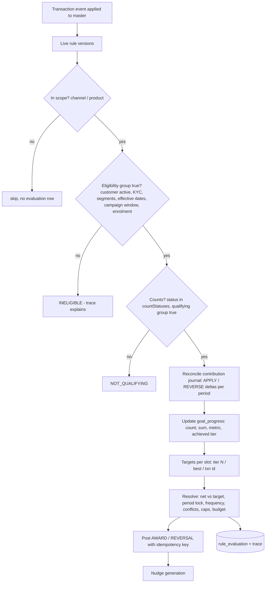
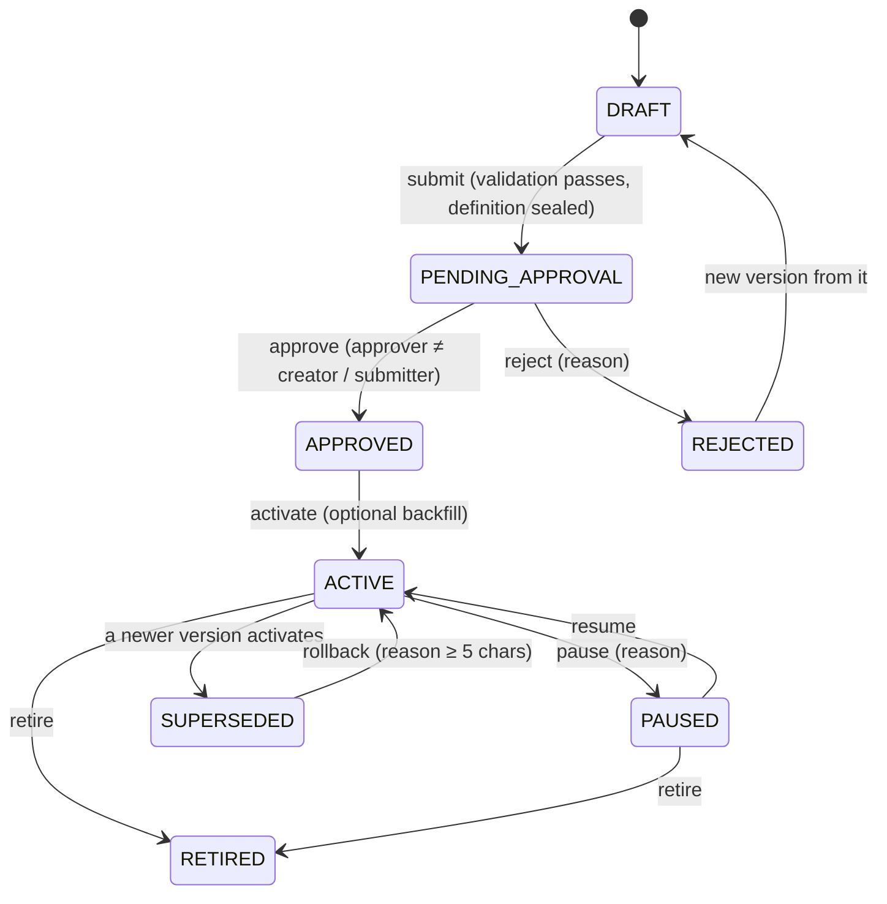

# 04 – Rule schema and evaluation logic

## 1. Rule definition (JSON)

A rule version is stored as normalised rows and as a sealed JSON definition (hash verified every time it is loaded; a mismatch raises `DEFINITION_TAMPERED`). The JSON is what the API accepts. The authoritative schema is `RuleDefinitionSchema` in [`packages/engine/src/ruleDef.ts`](../packages/engine/src/ruleDef.ts); examples are in [`samples/rules/`](../samples/rules).

```jsonc
{
  "name": "Card spend >= ₹10,000 in a month",
  "description": "...", "businessObjective": "Increase card spends",
  "category": "SPEND",                       // SPEND, FREQUENCY, BILL_PAYMENT, BALANCE, SAVINGS_GROWTH, COMBINED, ENGAGEMENT, OTHER
  "campaignCode": "MXP_ALWAYS_ON",
  "kind": "GOAL",                            // GOAL | PER_EVENT | COMBINED
  "scope": { "channels": ["CARD_POS","CARD_ONLINE"], "productCodes": [] },   // cheap pre-filter, empty = all
  "eligibility": { "type":"group","op":"AND","children":[ ... ] },          // who can earn
  "qualifying":  { "type":"group","op":"AND","children":[ ... ] },          // what counts
  "metric": { "type": "SUM", "operator": "GTE" },   // COUNT | SUM | AVG_BALANCE | MIN_BALANCE | BALANCE_GROWTH
  "period": { "type":"MONTHLY", "timezone":"Asia/Kolkata", "dateBasis":"TXN_DATE", "lateGraceDays":0 },
  "tiers": [ {"label":"₹10K spend","threshold":10000,"points":300}, {"label":"₹25K spend","threshold":25000,"points":400} ],
  "tierMode": "CUMULATIVE",                  // or HIGHEST_ONLY
  "perEvent": null,                          // { "mode":"FIXED|PER_AMOUNT", "points":1, "perAmount":100 }
  "combined": null,                          // { "components":[{"ruleCode":"...","minTier":1}] }
  "balancePolicy": { "gapFill": "NONE" },    // or CARRY_FORWARD
  "limits": { "frequency":"RECURRING", "maxOccurrences":null, "capPointsPerPeriod":null, "capPointsLifetime":null },
  "handling": { "reversal":"CLAWBACK", "countStatuses":["POSTED"] },
  "priority": 100,
  "conflict": { "group": null, "policy": "CUMULATIVE" },   // EXCLUSIVE_HIGHEST_POINTS | EXCLUSIVE_PRIORITY
  "effective": { "from": "2026-09-01", "to": null },
  "nudges": { "enabled": true, "nearTargetPct": 80 },
  "backfill": false
}
```

### 1.1 Condition tree

```json
{ "type": "group", "op": "AND", "negate": false, "children": [
  { "type": "condition", "field": "txn.type",            "operator": "EQ", "value": "PURCHASE" },
  { "type": "condition", "field": "txn.instrument_type", "operator": "EQ", "value": "CREDIT_CARD" },
  { "type": "group", "op": "AND", "negate": true, "children": [
    { "type": "condition", "field": "txn.category", "operator": "IN", "value": ["RENT"] } ] } ] }
```

* Groups nest to any depth; `negate` inverts the group.
* **Operators:** `EQ NE GT GTE LT LTE IN NOT_IN BETWEEN CONTAINS STARTS_WITH IS_NULL NOT_NULL`.
* **Fields** (the rule builder lists them with types and allowed values from reference data):

| Scope | Fields |
|---|---|
| `txn.*` | `type`, `category`, `channel`, `product_code`, `instrument_type`, `amount` (INR), `status`, `dr_cr`, `merchant_id`, `merchant_name`, `mcc`, `day_of_week` (1=Mon), `day_of_month`, `hour_of_day` (rule time zone) |
| `account.*` | `product_code`, `product_family`, `type`, `status`, `age_days` |
| `customer.*` | `segments` (array), `type`, `kyc_status`, `status` |
| `txn.attr.<key>` | any extensible attribute sent by the source |

* Money conditions compare in **minor units**: `txn.amount GTE 10000` is ₹10,000.00 exactly, so ₹9,999.99 never qualifies.
* **Missing values** fail positive operators (EQ, IN, GT …) and pass `NE`, `NOT_IN`, `IS_NULL`, so an unknown value never accidentally qualifies.
* Validation warns about values not found in reference data and errors on unknown fields, bad operators, inverted ranges, unsorted tiers and unknown component rules.

## 2. Evaluation flow



Balance goals are evaluated when a **snapshot** arrives (and at period close) using the same resolution step; combined goals are re-evaluated whenever a component's achieved tier changes.

### 2.1 Metrics

| Metric | Computation |
|---|---|
| `COUNT` | number of qualifying transactions in the period (refunds do not reduce a counted transaction unless fully reversed) |
| `SUM` | qualifying amount minus refunded amount |
| `AVG_BALANCE` | mean over each day in the period of the sum of closing balances over qualifying accounts, from `balance_snapshot` |
| `MIN_BALANCE` | lowest such daily total |
| `BALANCE_GROWTH` | last day's total minus the total on the day before the period |
| combined | number of component goals whose achieved tier ≥ `minTier` |

Balance metrics never come from transactions. If a required day is missing and `gapFill` is `NONE`, the progress is `DATA_UNAVAILABLE` and **no reward is issued**. An in-period average is provisional until the period's last snapshot has arrived or the period has ended.

### 2.2 Tiers

Tier *n* is achieved when `metric ≥ threshold` (or `>` for operator `GT`). `CUMULATIVE`: a customer at ₹25,000 earns tier 1 + tier 2 (300 + 400 = 700). `HIGHEST_ONLY`: only the highest achieved tier counts (one slot, `best`).

### 2.3 Award resolution (idempotent and convergent)

Rewards are not "append when a threshold is crossed". Each rule/customer/period has **slots** (`tier:1`, `tier:2`, `best`, or `txn:<id>` for per-event rules). For every slot the engine computes a **target** (points the slot should currently be worth) and compares it with the slot's **net** in the ledger:

* `target > net` → post an `AWARD` for the difference.
* `target < net` → if the rule is `CLAWBACK` and the drop is caused by a reversal or refund, post a `REVERSAL` of the difference; if `GRANDFATHER` or the drop is not reversal-driven, keep the points and record `NO_CHANGE`.
* `target = net` → nothing.

Because the result depends only on the facts, re-processing any event, in any order, any number of times, converges to the same ledger. The ledger idempotency key (`AW|…` / `RV|…`) is a second line of defence.

Order of checks in `resolveAndPost` (see `evaluator.ts`):

1. net and delta per slot;
2. downward moves (clawback or grandfather);
3. upward candidates: **closed-period lock** (late data for a closed period updates the metric but cannot earn), **frequency** (`ONCE`, `maxOccurrences`);
4. **conflict groups**: `EXCLUSIVE_HIGHEST_POINTS` (most points wins, then priority), `EXCLUSIVE_PRIORITY` (higher `priority` number wins, then rule code); a group member that already rewarded the customer for the period blocks the others;
5. **caps and budget** in deterministic order (higher priority first): per period, lifetime, campaign `points_budget`; points are trimmed, not dropped, when part of a cap remains;
6. post to the ledger and write the evaluation rows with an outcome and reason.

### 2.4 Time, periods and late data

* `MONTHLY`, `WEEKLY`, `QUARTERLY`, `DAILY` periods are computed in the **rule's time zone**; `CAMPAIGN` uses the campaign window. A transaction at 23:59 IST on the last day and one at 00:00 on the next day fall in different months regardless of UTC.
* `dateBasis` chooses transaction date or posting date.
* A period closes when today (rule time zone) is past `period_end + lateGraceDays`. Closing marks `CLOSED_ACHIEVED` or `CLOSED_NOT_ACHIEVED`. Anything arriving later updates the metric only (`PERIOD_CLOSED` outcome); nothing is awarded.
* Effective dates: a transaction outside `effective.from..to` (or the campaign window) never counts.

### 2.5 Reversals, refunds, statuses

* Refunds and reversals arrive as events linked by `originalSourceTxnId` (or as status changes on the original). The journal gets a `REVERSE` entry; progress falls; the reward is clawed back only if the new target is lower and the rule says `CLAWBACK`.
* `PENDING` counts only if the rule lists it in `countStatuses`; `FAILED` never counts.
* Status moves forward only; an older status arriving late is ignored and recorded.

### 2.6 Versioning and lifecycle



* Only **one** version per rule may be open (draft, pending, approved) at a time (`OPEN_VERSION_EXISTS`), and one live (ACTIVE / PAUSED).
* Editing is allowed only in `DRAFT`, by its owner (a `SYSTEM_ADMIN` may edit another maker's draft; the edit is audited).
* **Activation** can backfill the open period from the master. Without backfill, a new version counts only events arriving after activation. **Pause and resume do not catch up automatically**; run the backfill operation afterwards (see runbook).
* Goal progress and ledger rows keep the `rule_version_id` that produced them, so history is explainable after later changes.

### 2.7 Explainability

Every evaluation stores a trace: each condition with the field value seen, the operator, the expected value, and pass or fail; the metric before and after; the tier targets; and the reason for any block (cap, conflict, closed period, frequency). The Admin Console and Testing app render the same trace.

## 3. Worked examples (from the sample data)

| Customer | Facts | Rule | Result |
|---|---|---|---|
| CUST-1001 | card purchases ₹4,200 + ₹5,100 + ₹3,100 = ₹12,400 | `CARD_SPEND_10K` | tier 1 (₹10,000) → **300 XP** |
| CUST-1002 | ₹6,999 + ₹3,000 = **₹9,999** | `CARD_SPEND_10K` | one rupee short → 0 XP; `NEAR_TARGET` nudge |
| CUST-1002 | 9 UPI payments + 1 self-transfer | `UPI_10_TXNS` | self-transfer excluded → 9 < 10 → 0 XP |
| CUST-1003 | savings balance ₹31,000 → ₹61,000 over last month | `SAV_GROWTH_25K` | growth ₹30,000 → **400 XP** |
| CUST-1004 | ₹12,500 spent, then ₹3,000 refunded | `CARD_SPEND_10K` | awarded 300, then ₹9,500 < ₹10,000 → **−300 clawback** |
| CUST-1004 | balance ₹55,000 and card ₹10,500 last month | `BALANCE_PLUS_CARD` | both components met → **1,000 XP** |
| CUST-1001 | one transaction delivered 4 times | any | 1 award |
