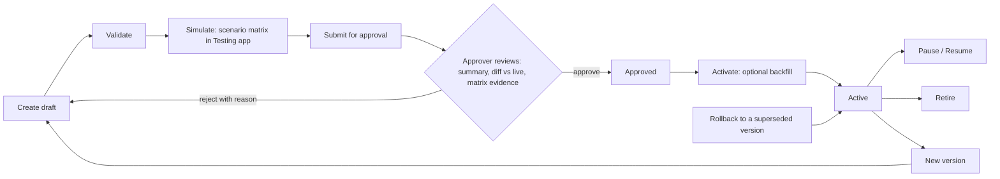

# 06 – Admin Console: UI and workflows

Served at `/` (React + Vite, `apps/web/src/admin`). Responsive from phone to wide desktop (below 900 px the sidebar becomes a slide-out menu; grids collapse at 1100 / 900 / 560 px; tables scroll horizontally; forms stack). Status badges carry text, not just colour.

## 1. Navigation and who sees what

| Page | Route | Purpose | Roles that can use it |
|---|---|---|---|
| Dashboard | `/` | Points awarded / reversed, active rules, approval queue, ingestion health, reconciliation, top rules | all |
| Rules | `/rules` | Searchable list with status, campaign, period, points issued | all (create: maker, admin) |
| Rule builder | `/rules/new`, `/rules/:code/versions/:v/edit` | Create / edit a draft | `RULE_MAKER`, `SYSTEM_ADMIN` |
| Rule detail | `/rules/:code` | Tabs: Summary (plain English, lifecycle strip, simulation evidence), History (versions and activity), Compare (diff), JSON | all (actions by permission) |
| Campaigns | `/campaigns` | Window, budget, enrolment mode, status, linked rules | all (edit: maker, admin; status: activators) |
| Evaluations | `/evaluations` | Search outcomes with full trace, export | all (export: ops, auditor, admin) |
| Ledger | `/ledger` | Immutable XP entries, adjustments | all (export: ops, auditor, admin) |
| Customers | `/customers`, `/customers/:ref` | 360: accounts, progress, ledger, evaluations, nudges | customers:read |
| Ingestion | `/ingestion` | Events, history, replay, batches, dead letters | ops:read (actions: operations, admin) |
| Reconciliation | `/reconciliation` | Run, see breaks, source reconciliation | ops:read |
| Audit | `/audit` | Search, verify the hash chain, export | audit:read |
| Administration | `/admin` | Users, API keys, engine configuration, customer import | `SYSTEM_ADMIN` |

Buttons the current user cannot use are hidden or disabled with a reason; the server enforces the same rule regardless.

## 2. The rule builder

A form with numbered cards and a **Form / JSON** switch (the JSON tab lets you paste a definition and apply it to the form). A side panel shows **Live validation** and **What this rule does**.

1. **Basics** – code, name, description, business objective, category, campaign, kind (goal, per-event, combined), and the scope (channels, products).
2. **Who is eligible** – condition tree for customer, account and segment checks.
3. **Which transactions count** (for balance goals: **Which accounts count**) – condition tree for the qualifying items.
4. **Goal and period** (combined rules: **Component goals and period**) – metric, period type, time zone, date basis, late grace days.
5. **Reward** – tiers table (threshold and points, add and remove rows) and tier mode; per-event rules use fixed or per-amount points.
6. **Limits and reversals** – frequency, maximum occurrences, per-period and lifetime caps, reversal policy, statuses that count, balance gap policy.
7. **Priority, conflicts, dates and nudges** – priority, conflict group and policy, effective dates, nudge settings.

The condition editor supports nested groups with an AND / OR switch and negation. For each condition you choose a field from the catalogue (or a custom `txn.attr.*` key); the operators offered depend on the field's type; values use drop-downs for enums, check-box lists for `IN` / `NOT_IN`, range inputs for `BETWEEN`, and number inputs for amounts and counts.

**Validation** runs as you edit against the server (`POST /api/rules/validate`) and is also repeated on submit. Each message names the field and says what to fix, for example "Tier thresholds must increase". Errors block submission; warnings (for example a value that is not in reference data) do not. **What this rule does** renders the definition as plain English; the same text appears on the rule's Summary tab so approvers read it without opening the form.

## 3. Workflow

The rule detail page shows the lifecycle as a progress strip. When a version moved forward without a passing simulation, that step is shown as **"No simulation"**; an approved version shows that it is waiting for an activator. The approver sees:

* the plain-language summary and full definition;
* a **diff against the live version** (fields added, removed, changed);
* **simulation evidence**: the latest scenario-matrix run recorded against this rule version (`SIMULATION_RUN` in the audit log, written by the server when a matrix is run against a stored version, not supplied by the browser), with passed / total counts; with no evidence the approval dialog says so;
* the maker's change note.

### Maker-checker

* The creator or submitter of a version can **never** approve or reject it (`MAKER_CHECKER`), even if they hold `RULE_APPROVER`.
* Only `RULE_APPROVER` holds `rules:approve`; activating needs `rules:activate` (approver, operations, admin).
* Manual XP adjustments follow the same rule: the requester cannot decide.

### Activation options

* **Backfill** replays the master for the open period so customers who already qualified earn immediately. Off by default; the activation dialog explains both choices.
* After a **pause / resume**, nothing is automatically caught up. Use *Backfill* on the rule page (or `POST /api/ops/rules/:code/backfill`).

### Version history, diff and rollback

The History tab lists every version with status, author, approver, activator and dates. The Compare tab diffs any two versions. **Rollback** (activators only) re-activates a superseded version after a reason of at least 5 characters; the version that was live becomes superseded; all of it is audited.

## 4. Other workflows

* **Evaluation search:** filter by rule, customer, outcome, trigger, period and date; open a row to see the trace: every condition with the value seen, pass / fail, the metric before and after, the tier targets, and why points were or were not awarded (cap, conflict, closed period, frequency). Export CSV.
* **Customer 360:** goals in progress with progress bars, achieved tiers, XP balance, recent ledger entries, nudges and why suppressed.
* **Ingestion triage:** filter rejected / suspended / dead-letter events, read the verbatim payload and stage history, fix at the source, replay.
* **Adjustments:** Operations requests points with a reason; an approver approves or rejects; a ledger `ADJUSTMENT` is posted on approval.
* **Reconciliation:** run all checks; breaks are listed with expected vs actual and the entity.
* **Audit:** every login, failure, lifecycle change, adjustment, export, user and key change; **Verify chain** recomputes the hashes and reports the first broken row if any.

## 5. UX rules applied

* Consequential actions (approve, reject, pause, retire, roll back, close a campaign, decide an adjustment) open a dialog; a reason is mandatory where the API requires one.
* Server error messages are shown verbatim in an inline banner with the error code; field errors are attached to the field.
* Empty, loading and error states exist on every table.
* Money is displayed in ₹ with Indian grouping; periods and dates in the rule's time zone, labelled.
* The environment is shown in the header (`DEV`, `STAGING`, `PROD`), with a "Non-production environment" note outside prod.
