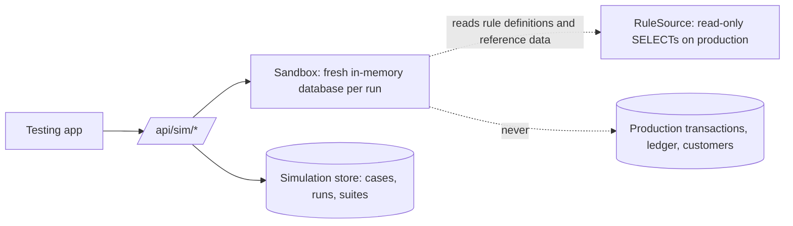

# 07 – Testing and Simulation app

A separate, responsive web app served at **`/testing/`** (`apps/web/src/testing`, teal theme so it cannot be mistaken for the Admin Console). It signs in with the same accounts; the roles that can use it are `QA_ENGINEER`, `RULE_MAKER`, `RULE_APPROVER` and `SYSTEM_ADMIN` (saving cases: `QA_ENGINEER`, `RULE_MAKER`, `SYSTEM_ADMIN`).

## 1. Production isolation



* Every run builds a **new in-memory database**, loads reference data, the chosen rule versions and a synthetic customer, then runs the **same engine code** as production (`Engine`, `ingestAndProcess`, period close, nudges). A rule that passes here behaves the same in production.
* The sandbox sees production only through `RuleSource` (rule definitions, campaigns, reference data) which issues `SELECT`s. Nothing is written to production tables; saved cases and run history live in a separate database (`MXP_SIM_DB`). `packages/engine/test/integration/simulation.test.ts` ("production isolation") asserts that simulations, matrices, performance runs and previews leave the production database unchanged.
* Synthetic customers and transactions use `SIM-…` references and are discarded with the sandbox.
* Caveats: simulations are synchronous and CPU-bound, so run them on a separate API instance in production; the production connection used by `DbRuleSource` is not enforced read-only at the driver level, so give the API a read-only database role for this path in production (see [10](10-deployment-security-runbooks.md)).

## 2. Pages

| Page | What it does |
|---|---|
| **Playground** (`/playground`) | Build one customer story and run it. 1 Rules to test (stored version, latest, or a **what-if copy** of a definition you can tweak without saving; multiple rules to test overlap; "also run every live rule"). 2 Test customer (status, KYC, type, segments, consent). 3 Accounts (product, opened date, status). 4 **What happens**: ordered steps with add, edit, reorder, delete. 5 Expected results (optional). **Run simulation**; **Save as test case**; **Scenario JSON** view with download and "apply to builder". |
| **Scenario matrix** (`/matrix`) | Pick a rule and version; **Generate and run** produces a full set of cases in one click, or **Generate, run and save to library**. Shows a scenario matrix with pass / fail per case, grouped by category; open any case in the Playground; download JSON. Running it against a stored version records `SIMULATION_RUN` evidence for approvers. |
| **Real customers** (`/preview`) | Replay actual customer history (read from the master, in the sandbox) through any version, including drafts awaiting approval: one customer, or the 25 active customers with the most transactions (up to 50 via the API) ("N of M customers would earn X XP"). |
| **Test cases** (`/cases`) | Library with search by rule and category; run one, a selection or all; open, clone, archive; run against **pinned** versions or whatever is **live**. |
| **Regression runs** (`/suites`) | Every suite run is kept with totals and per-case results; **Run full regression**; download JSON or CSV. |
| **Performance** (`/performance`) | Synthetic load (customers × events, with a duplicate ratio): throughput, p50 / p95 / p99 latency per event, ledger totals, **duplicate awards = 0**, reconciliation result. Capped at 20,000 events per run. |

## 3. Scenario language

A scenario is JSON, shared by the UI, the API and saved cases:

```json
{ "timezone": "Asia/Kolkata", "asOf": "2026-10-10",
  "customer": { "status": "ACTIVE", "kycStatus": "FULL", "segments": ["AFFLUENT"], "nudgeConsent": true },
  "accounts": [ { "ref": "SA-1", "productCode": "SAV_PREMIUM" }, { "ref": "CC-1", "productCode": "CC_PLATINUM" } ],
  "steps": [
    { "kind": "BALANCE", "account": "SA-1", "date": "2026-10-01", "toDate": "2026-10-09", "balance": 55000 },
    { "kind": "TXN", "id": "p1", "at": "2026-10-03T14:00", "type": "PURCHASE", "channel": "CARD_ONLINE", "amount": 9999, "accountRef": "CC-1", "repeat": 2 },
    { "kind": "TXN", "id": "p2", "at": "2026-10-04", "type": "PURCHASE", "channel": "CARD_POS", "amount": 1, "accountRef": "CC-1" },
    { "kind": "REFUND", "id": "r1", "original": "p2", "at": "2026-10-06", "amount": 1 },
    { "kind": "CLOSE", "at": "2026-11-02" } ] }
```

* `at` accepts an ISO instant or a local `YYYY-MM-DD` / `YYYY-MM-DDTHH:mm` in the scenario time zone.
* `repeat` re-delivers the identical event; `resendAs` delivers the same transaction under new event ids; `receivedAt` models **late arrival**.
* A card purchase on a card account uses that account's card unless `instrumentRef` says otherwise.
* `asOf` advances the sandbox clock and closes elapsed periods before the final result is taken.

## 4. What the matrix generates

For each rule the generator derives cases from the rule itself (thresholds, tiers, qualifying and eligibility conditions, exclusions, period, caps), so a changed rule gets different cases.

| Category | Examples |
|---|---|
| POSITIVE | exactly at the threshold; above it; each tier; multiple transactions that add up; per-event rules |
| BOUNDARY | one paisa / one unit below and at the threshold (₹9,999.99 vs ₹10,000); first and last minute of the period; day before and after the effective window |
| NEGATIVE | transactions outside the qualifying conditions (other channel, category, product, below the minimum amount); each exclusion honoured |
| ELIGIBILITY | blocked customer, customer failing each eligibility condition |
| DUPLICATE | the same event delivered repeatedly and the same transaction under new event ids: one reward |
| REVERSAL / REFUND | reversal after reward (clawback or grandfather as configured); partial refund that drops below the threshold; partial refund that does not |
| STATUS | pending counts only once posted; pending never counted; failed ignored |
| PERIOD | late data after the period closed earns nothing; before and after the rule window |
| CAP | per-period and lifetime caps, frequency once / max occurrences |
| DATA | missing balance days give `DATA_UNAVAILABLE` rather than a reward |
| COMBINED | each component alone does not earn the combined reward; both do |

The matrix for the six use-case rules plus the per-event rule runs 100 % green on the shipped rules and is part of the regression suite (`packages/engine/test/regression/matrix.test.ts`).

## 5. Expected results

An optional block compared with the actual outcome; each comparison becomes a **check** with expected vs actual and a pass / fail badge:

`totalPoints`, `pointsByRule`, `achievedTier`, `metric`, `awards`, `reversals`, `noDuplicateAwards`, `nudges` (by type), `rejectedEvents`, `duplicateEvents`, `outcomes` (rule outcome at a given step), `progressStatus`.

## 6. What a result shows

* **Summary:** pass / fail, total XP, per-rule XP, awards, reversals, duplicates, event counts, duration.
* **Checks:** expected vs actual.
* **Timeline:** one row per step with what the engine did, **progress before and after** for each rule, ingestion outcome (accepted, duplicate, rejected with error codes).
* **Why:** for each evaluation, the outcome and reason code (for example `CAPPED`, `SUPPRESSED`, `PERIOD_CLOSED`, `DATA_UNAVAILABLE`), the **condition-by-condition trace** (field, operator, expected, actual, pass / fail), tier targets, and caps, exclusions and conflicts applied.
* **Ledger and nudges produced.**
* **Errors and log.**
* **Downloads:** JSON (everything) and CSV (sections `RUN`, `CHECK`, `EVALUATION`, `LEDGER`).

## 7. Typical flows

1. **Authoring:** maker builds a draft in the Admin Console → opens it in the Matrix page → fixes failing cases → submits. The approver sees the evidence.
2. **Change impact:** QA clones the live definition as a what-if, changes a threshold, and runs the saved regression suite pinned to the live version and the what-if side by side.
3. **Impact on real customers:** preview a draft on the top 25 customers to estimate cost and spot surprises before approval.
4. **Release gate:** run the full regression after each rule activation; every run is stored so a regression is attributable.
5. **Capacity:** run Performance with the expected daily volume to check latency and idempotency.
