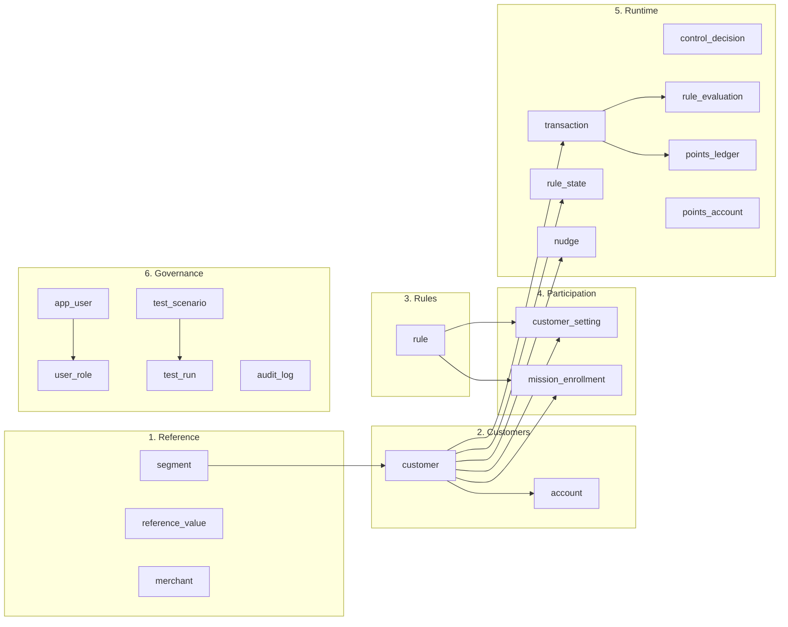
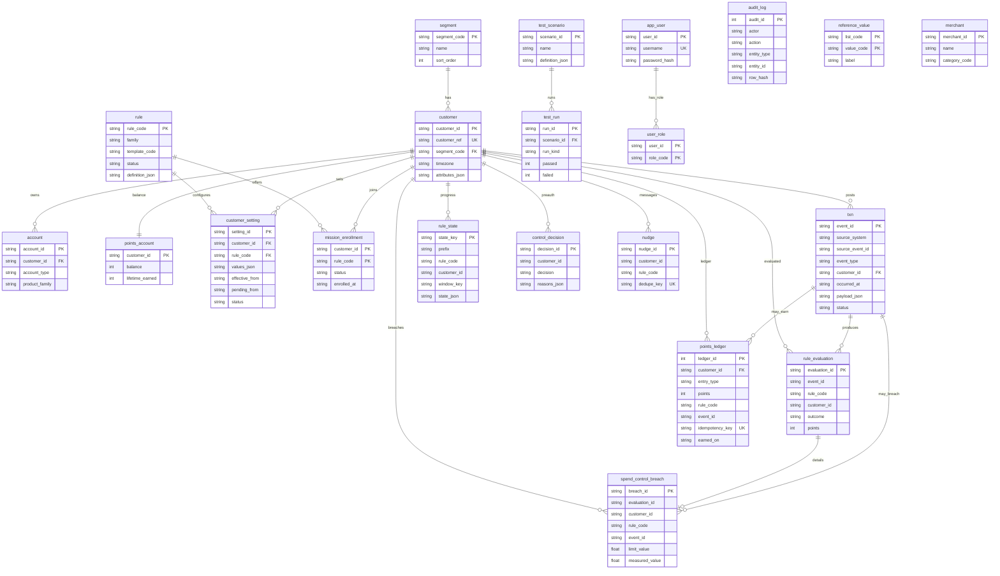
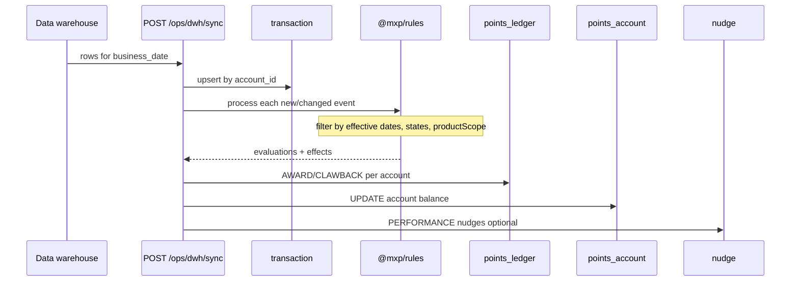

# MXP v5 — Entity relationship diagram

Source: [`packages/platform/src/schema.sql`](../packages/platform/src/schema.sql). Narrative: [03-data-model.md](03-data-model.md).

## Overview (areas)

## Full ERD (keys and relationships)

> Notes for GitHub Mermaid: the SQL table `"transaction"` is drawn as `txn` (reserved word). Composite keys use a single marker (`PK` only) — GitHub’s Mermaid build rejects `PK,FK`.

## Logical links (no FK in SQLite)

| From | Column | To | Why |
|---|---|---|---|
| `rule` | `template_code` | `@mxp/rules` template file | Templates are not DB rows |
| `rule` | `states` (in JSON) | `reference_value` list `states` | Geo targeting |
| `rule` | `product_scope` | CASA / CREDIT_CARD / ANY | Product-level rules |
| `rule_state` / evaluations / ledger / nudge | `rule_code` | `rule.rule_code` | Soft link so history survives retirement |
| `transaction` | `reversal_of` | `transaction.event_id` | Refunds |
| `nudge` | `kind = PERFORMANCE` | (no rule) | Overall portfolio performance |

## Path of one DWH day

Open this file in an editor with Mermaid preview (or GitHub) to render the diagrams.
