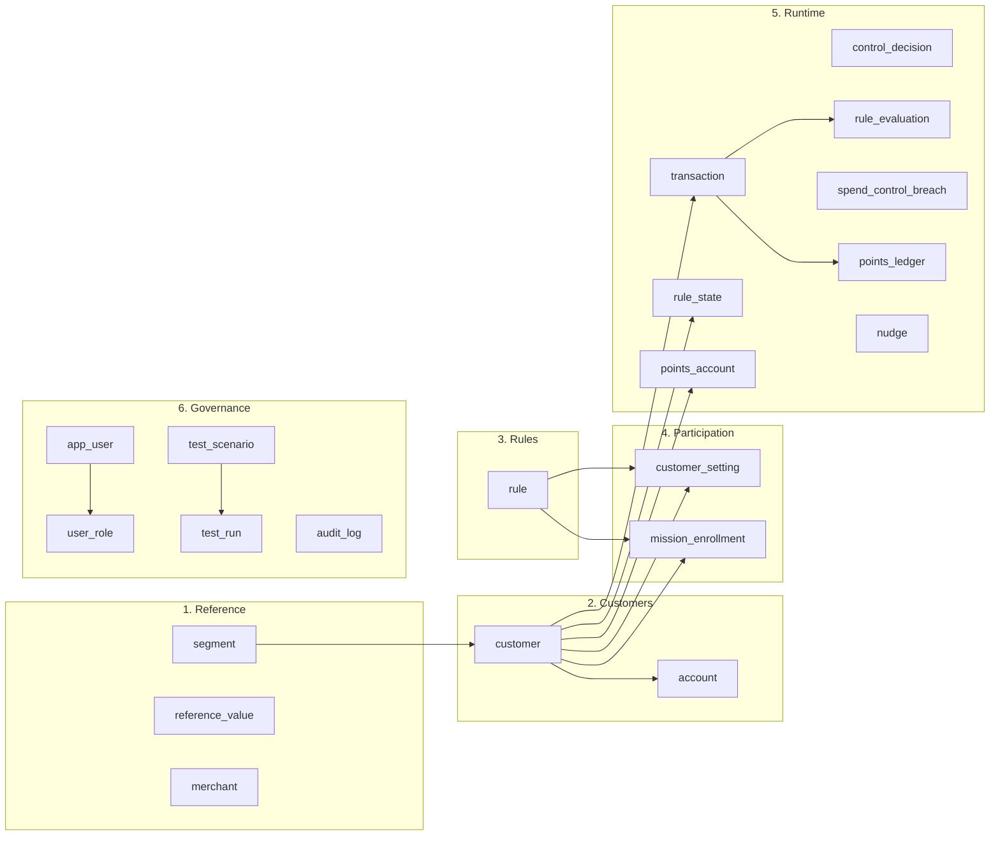
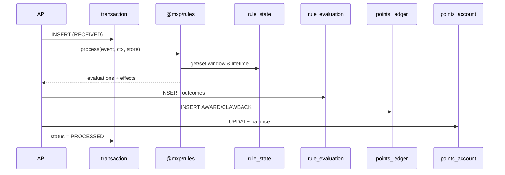

# MXP v3 — Entity relationship diagram

Source: [`packages/platform/src/schema.sql`](../packages/platform/src/schema.sql). Narrative: [03-data-model.md](03-data-model.md).

## Overview (areas)



## Full ERD (keys and relationships)

```mermaid
erDiagram
  segment ||--o{ customer : "segment_code"
  customer ||--o{ account : "customer_id"
  customer ||--|| points_account : "customer_id"

  customer ||--o{ customer_setting : "customer_id"
  rule ||--o{ customer_setting : "rule_code"
  customer ||--o{ mission_enrollment : "customer_id"
  rule ||--o{ mission_enrollment : "rule_code"

  customer ||--o{ transaction : "customer_id"
  transaction ||--o{ rule_evaluation : "event_id"
  transaction ||--o{ spend_control_breach : "event_id"
  transaction ||--o{ points_ledger : "event_id"
  rule_evaluation ||--o| spend_control_breach : "evaluation_id"

  customer ||--o{ rule_state : "customer_id"
  customer ||--o{ control_decision : "customer_id"
  customer ||--o{ points_ledger : "customer_id"
  customer ||--o{ nudge : "customer_id"
  customer ||--o{ rule_evaluation : "customer_id"
  customer ||--o{ spend_control_breach : "customer_id"

  test_scenario ||--o{ test_run : "scenario_id"
  app_user ||--o{ user_role : "user_id"

  segment {
    text segment_code PK
    text name
    int sort_order
  }
  customer {
    text customer_id PK
    text customer_ref UK
    text segment_code FK
    text timezone
    text attributes_json
  }
  account {
    text account_id PK
    text customer_id FK
    text account_type
    text product_family
  }
  rule {
    text rule_code PK
    text family
    text template_code
    text status
    text definition_json
  }
  customer_setting {
    text setting_id PK
    text customer_id FK
    text rule_code FK
    text values_json
    text effective_from
    text pending_from
    text status
  }
  mission_enrollment {
    text customer_id PK_FK
    text rule_code PK_FK
    text status
    text enrolled_at
  }
  transaction {
    text event_id PK
    text source_system
    text source_event_id
    text event_type
    text customer_id FK
    text occurred_at
    text payload_json
    text status
  }
  rule_state {
    text state_key PK
    text prefix
    text rule_code
    text customer_id
    text window_key
    text state_json
  }
  control_decision {
    text decision_id PK
    text customer_id
    text decision
    text reasons_json
  }
  rule_evaluation {
    text evaluation_id PK
    text event_id
    text rule_code
    text customer_id
    text outcome
    int points
  }
  spend_control_breach {
    text breach_id PK
    text evaluation_id
    text customer_id
    text rule_code
    text event_id
    real limit_value
    real measured_value
  }
  points_ledger {
    int ledger_id PK
    text customer_id FK
    text entry_type
    int points
    text rule_code
    text event_id
    text idempotency_key UK
    text earned_on
  }
  points_account {
    text customer_id PK_FK
    int balance
    int lifetime_earned
  }
  nudge {
    text nudge_id PK
    text customer_id
    text rule_code
    text dedupe_key UK
  }
  test_scenario {
    text scenario_id PK
    text name
    text definition_json
  }
  test_run {
    text run_id PK
    text scenario_id FK
    text run_kind
    int passed
    int failed
  }
  app_user {
    text user_id PK
    text username UK
    text password_hash
  }
  user_role {
    text user_id PK_FK
    text role_code PK
  }
  audit_log {
    int audit_id PK
    text actor
    text action
    text entity_type
    text entity_id
    text hash
  }
  reference_value {
    text list_code PK
    text value_code PK
    text label
  }
  merchant {
    text merchant_id PK
    text name
    text category_code
  }
```

## Logical links (no FK in SQLite)

These are enforced in application code / the rules engine:

| From | Column | To | Why |
|---|---|---|---|
| `rule` | `template_code` | `@mxp/rules` template file | Templates are not DB rows |
| `rule_state` / `rule_evaluation` / `points_ledger` / `nudge` | `rule_code` | `rule.rule_code` | Soft link so history survives retirement |
| `transaction` | `reversal_of` | `transaction.event_id` | Refunds |
| `transaction` | `account_id` | `account.account_id` | Optional |
| `merchant` | `category_code` | `reference_value` (categories) | Lookup |
| `audit_log` | `entity_id` | any table | Soft reference by `entity_type` |

## Path of one event



Open this file in an editor with Mermaid preview (or GitHub) to render the diagrams.
